# 金甲虫 ADB 助手

**GoldenBeetle · 在 Android 手机上管理你的 Android 设备**

[](https://github.com/Antman2023/goldadbhelper/actions/workflows/android-ci.yml)
[](LICENSE)
[](app/build.gradle)
[](app/build.gradle)

从连接、查看设备信息，到文件传输、应用管理和命令终端，把常用 ADB 工作放在一个应用里。支持 TCP / USB ADB，提供 Android 11+ 无线调试配对、外部 ADB server、投屏与 Fastboot 入口。

项目使用独立的 Java ADB 协议实现，提供 TCP、USB 和 Android 11+ 无线调试配对入口。应用名称、图标、包名和开发签名均为独立身份。

> **开发状态：`0.1.3-dev`，Android 4.4 / API 19+。** 当前提供开发候选源码与 CI 构建，尚未完成全面设备验收。截图来自下方明确标注的历史开发包和隔离 Android 模拟器；历史结果不代表当前候选、真机或全部厂商兼容性。

[运行截图](#运行截图) · [获取与安装](#获取与安装) · [开始使用](#开始使用) · [从源码构建](#从源码构建) · [验证与限制](#验证与限制) · [文档](#更多文档)

## 功能概览

| 模块 | 已接入的能力 |
| --- | --- |
| 设备连接 | TCP/USB ADB、独立 RSA 身份、连接历史、无线调试配对；外部 ADB server 设备列表与会话选择 |
| 设备信息 | 系统、设备、存储与运行状态读取 |
| 实用工具 | DPI、分辨率、动画、应用冻结和重启等操作 |
| 远程控制 | 基于 scrcpy 2.4 的 H.264/MediaCodec 投屏与多点触控；独立截图兼容模式 |
| 文件管理 | 目录导航、多选、上传下载、SHA-256 校验、复制/移动、取消与部分结果报告 |
| 应用管理 | 名称和图标、筛选搜索、启动、启停、卸载、清除数据、APK/分包安装及导出；本机应用选择与安装前快照核对 |
| 进程管理 | 读取设备进程并按应用分组 |
| 命令终端 | 持久 PTY、命令历史、快捷命令、Ctrl-C、退出和重新启动 |
| Fastboot | USB 协议、getvar、镜像传输、刷写、启动和重启 |

设备页包含七个模块。`0.1.3-dev` 会预创建相邻模块的真实控件，首次设备读取在提交选中该模块后开始。终端离开页面时关闭 PTY，返回后重新连接并保留显示与未提交输入；详见 [邻页预创建记录](tests/navigation/neighbor/RESULT.md)。

## 运行截图

以下 **15 张均为金甲虫实际运行截图**，来自 2026-10-12 的隔离官方 Android 8.0 / API 26 / x86 模拟器。点击任意图片查看 480 × 800 原图。仅做无损 PNG 压缩，没有重绘界面或替换显示数据。

图片采用统一宽度单列展示，标题与说明独立排布；11 张稳定页面与操作截图在下方，4 张导航过渡帧收在末尾的折叠区。

### 设备与日常管理

本组及后面的操作、导航图来自 **`0.1.3-dev` 冻结包（APK SHA-256 前缀 `74fabeac`）**。这是仓库取消竞态修复之前的历史开发包，不应当作最新 `main` 的完整验收。完整哈希、来源与测试边界见 [截图说明](docs/screenshots/README.md)。

#### 设备信息

<a href="docs/screenshots/device-information.png">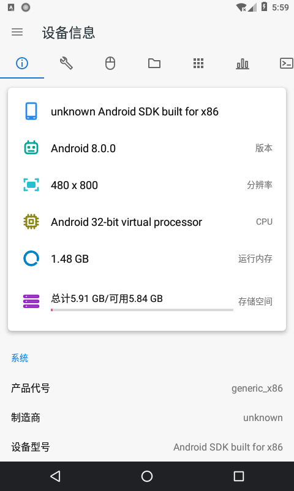</a>

系统、分辨率、处理器、内存与存储。

#### 实用工具

<a href="docs/screenshots/tools-overview.png">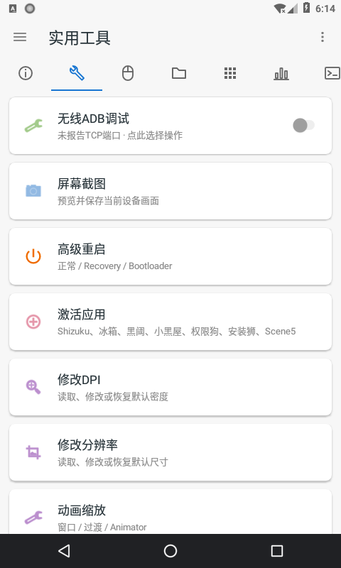</a>

无线 ADB、截图、重启、DPI 与分辨率入口。

#### 文件管理

<a href="docs/screenshots/file-browser.png">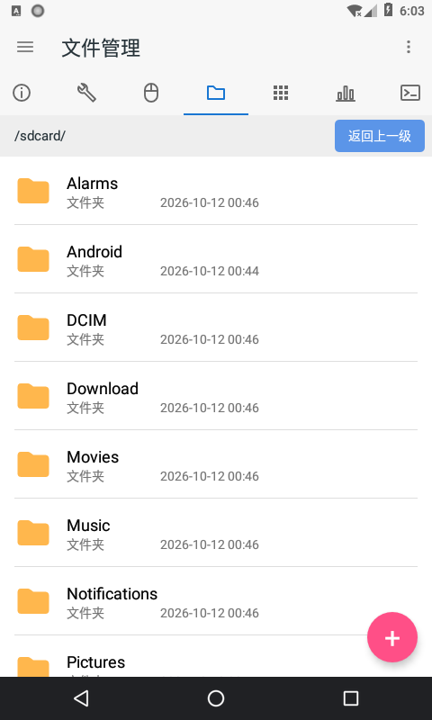</a>

模拟器共享存储的实际目录列表。

#### 应用管理

<a href="docs/screenshots/app-manager.png">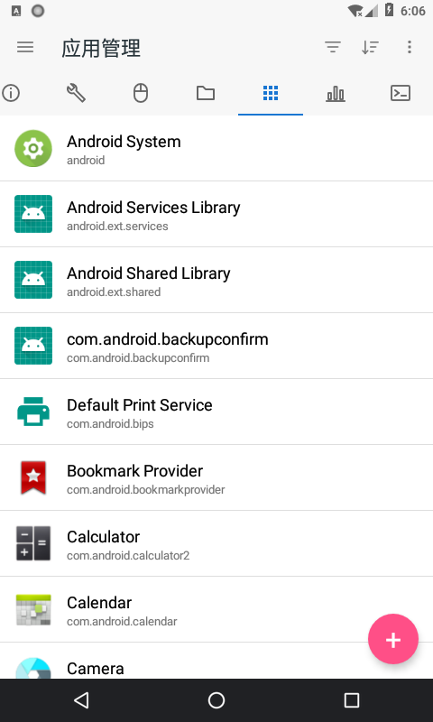</a>

目标设备的实际应用名称、包名与图标。

#### 进程管理

<a href="docs/screenshots/process-manager.png">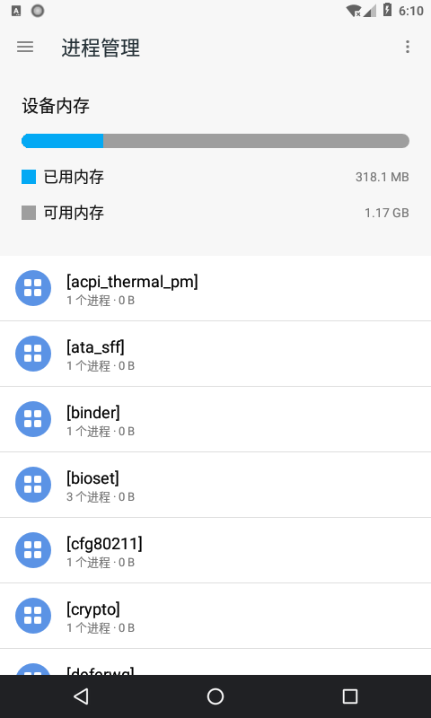</a>

内存概览与实际进程分组。

#### 命令终端

<a href="docs/screenshots/terminal.png">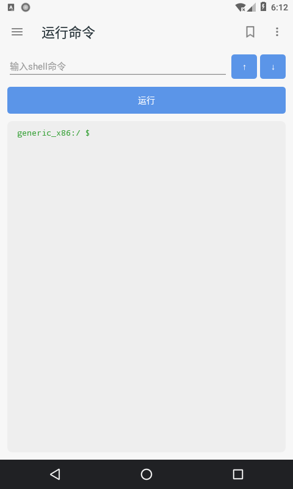</a>

首次进入后的真实 PTY 提示符。

### 文件操作与页面状态

#### 文件操作菜单

<a href="docs/screenshots/file-actions.png">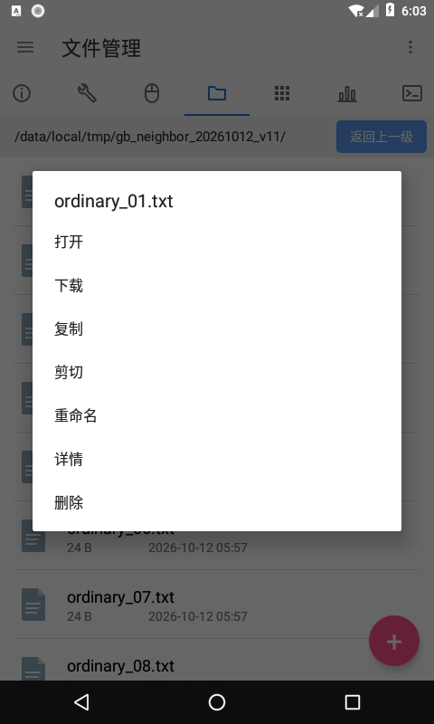</a>

普通测试文件的打开、下载、复制等入口。

#### 终端回访

<a href="docs/screenshots/terminal-draft.png">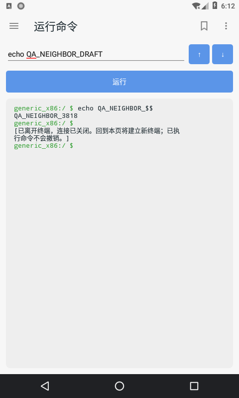</a>

保留输出与未执行草稿，重新建立 PTY。

#### 工具列表滚动

<a href="docs/screenshots/tools-scrolled.png">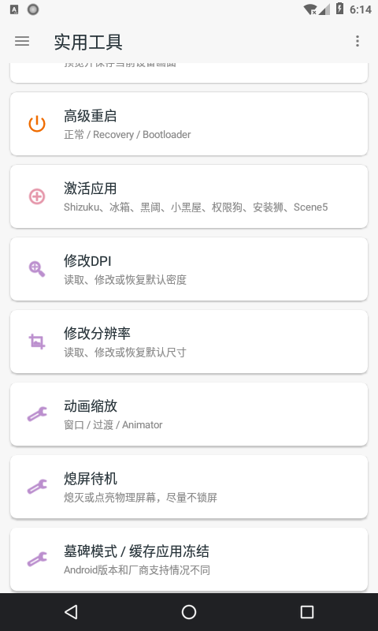</a>

下方工具入口与收起的模块栏。

### 本机应用选择：浅色与深色

以下两张来自更早的 **`0.1.1` 热修包（APK SHA-256 前缀 `c140b368`）**，同样在 API 26 隔离模拟器采集。用于展示本机选择器的列表、搜索、选中与主题；不能证明新版 Android 的包可见性或厂商权限问题已解决。

#### 本机应用 · 浅色

<a href="docs/screenshots/local-apps-light.png">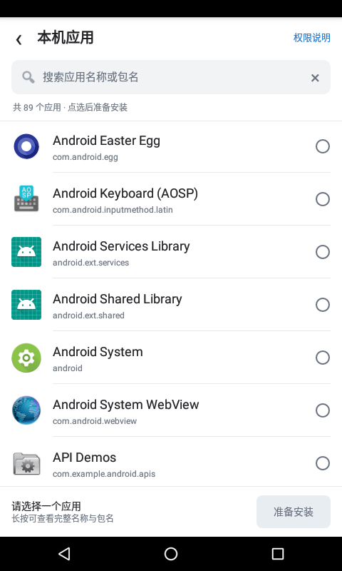</a>

实际 PackageManager 列表与应用图标。

#### 本机应用 · 深色

<a href="docs/screenshots/local-apps-dark.png">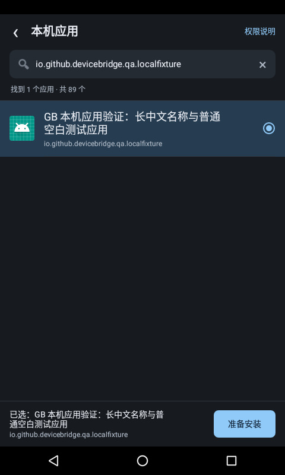</a>

搜索并选中专用空白测试应用。

### 导航验收证据

<details>
<summary>展开查看 4 张真实横向滑动过渡帧</summary>

以下画面来自上述 `0.1.3-dev` 冻结包，是手势过程中的中间帧。横向裁切、灰色控件与加载占位均为实际状态。预览会呈现邻页控件，正式选中后才开始首次设备读取；远控图展示设置入口，不代表投屏已成功。

#### 信息 → 工具

<a href="docs/screenshots/preview-tools.png">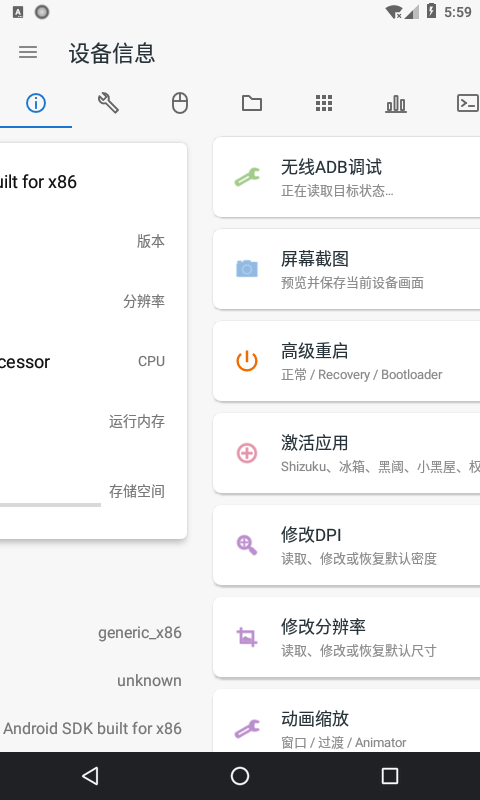</a>

首次横滑中，工具卡片已进入画面。

#### 工具 → 远控

<a href="docs/screenshots/preview-remote-options.png">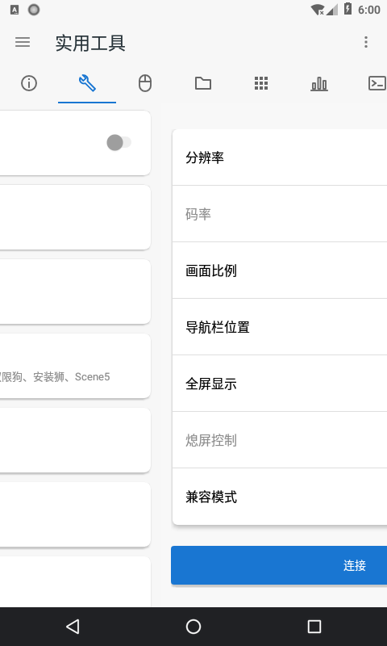</a>

远控参数与连接按钮；没有启动投屏。

#### 远控 → 文件

<a href="docs/screenshots/preview-files.png">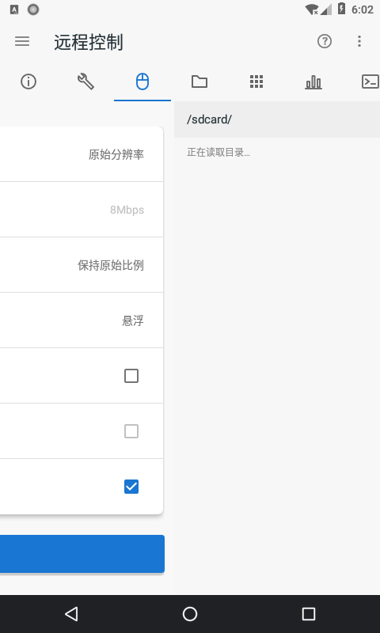</a>

路径栏与待加载结构；尚未读取目录。

#### 进程 → 终端

<a href="docs/screenshots/preview-terminal.png">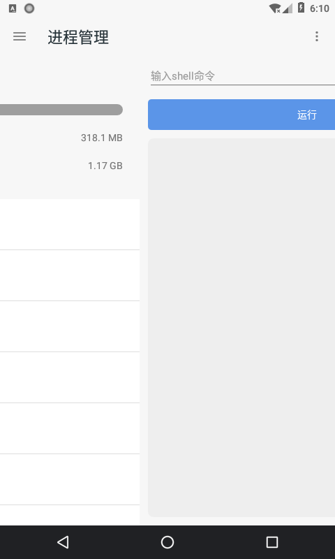</a>

输入框、运行按钮与输出区；尚未打开 PTY。

</details>

## 获取与安装

- **体验开发版：** 打开 [Android CI](https://github.com/Antman2023/goldadbhelper/actions/workflows/android-ci.yml)，选择成功的构建，在 Artifacts 下载 `goldadbhelper-ci-<提交号>`。通常需要登录 GitHub；产物保留 14 天。解压后按其中的 SHA-256 校验文件核对 APK。
- **自己构建：** 见下文 [从源码构建](#从源码构建)。源码版本以 [`app/build.gradle`](app/build.gradle) 为准。
- **正式版本：** 不将 CI 产物视为正式稳定版；发布机制与签名要求见 [发布指南](docs/RELEASING.md)。

**安装前注意签名。** CI 使用开发签名，不应假定不同构建具有相同签名。正式密钥、另一工作区的开发密钥或不同 CI 构建可能无法直接覆盖安装。先备份必要数据，再决定是否卸载旧包；卸载会清除本应用私有数据与 ADB 身份，之后可能需要重新授权或配对。不要为覆盖安装关闭系统安全检查。

## 环境与兼容性

- **运行应用的手机：** Android 4.4 / API 19 起，`targetSdk` 为 35；包名为 `io.github.devicebridge.goldenbeetle`。
- **无线调试配对的目标：** Android 11 或更高版本，开启开发者选项与无线调试。
- **USB 连接：** 应用所在手机需要 USB Host/OTG 支持，目标设备需要开启 USB 调试并确认授权。
- **设备能力：** 命令、权限、编码器和文件操作的可用性取决于目标 Android 版本及系统实现。
- **本地访问：** 文件功能需要相应存储权限；应用列表受到系统权限与包可见性规则影响。

API 19 兼容层使用 D8/L8 库回移植和 AndroidX MultiDex。历史安装与运行结果按其 APK 哈希记录，详见 [旧版 Android 兼容性](docs/API19_COMPATIBILITY.md)。

## 开始使用

1. 在你拥有或获准管理的目标设备上开启开发者选项和相应调试方式。
2. 安装本应用，打开连接页，选择一种连接方式：
   - **TCP ADB：** 输入已启用 ADB 的目标地址和端口。
   - **USB ADB：** 通过 OTG 连接目标设备，批准本机 USB 权限及目标设备的调试授权。
   - **Android 11+ 无线调试：** 在目标设备打开“使用配对码配对设备”，输入配对地址、配对端口和六位码。成功后回到无线调试主页面，使用那里显示的**连接端口**手动连接。
   - **外部 ADB server：** 通过“刷新设备列表”的入口配置已运行的 server，再选择在线设备。详见 [外部服务说明](docs/EXTERNAL_ADB_SERVER.md)。
3. 核对当前目标，进入设备信息、文件、应用或运行命令等模块。

无线配对端口与连接端口通常不同。外部 ADB server 客户端可以断开自身连接或请求停止共享服务，无法远程启动已经停止的 daemon；停止服务会影响其所有客户端。

删除文件、清除应用数据、更改系统设置、重启和 Fastboot 刷写前，请核对目标与影响。取消不能撤销已经完成的设备修改；上传中断可能留下部分文件，结果为 `UNKNOWN` 时应先检查设备状态再重试。

## 从源码构建

### 脚本构建

现有脚本面向 Linux Bash 环境；Windows 可在 WSL 中准备独立的 Linux JDK 和 Android SDK。WSL 内的脚本不能直接使用 Windows 版 SDK 工具。

需要带 `jdk.compiler` 模块的 JDK、Android SDK Platform 35、Build Tools 35.0.0、Python 3，以及 Bash、`find`、`sort`、`tee`、`sha256sum` 等工具。将 `java` 和 `keytool` 加入 `PATH`。固定版本第三方 JAR/AAR、JNI 库、源码和许可证已随仓库保留。

```bash
git clone https://github.com/Antman2023/goldadbhelper.git
cd goldadbhelper

# 改成当前构建环境中实际的 SDK 路径。
export ANDROID_HOME=/path/to/android-sdk

# 重建元数据 helper 和 scrcpy 服务端。
bash tools/build-servers.sh

# 构建、开发签名并校验 APK。
bash tools/build-apk.sh
```

| 主要输出 | 内容 |
| --- | --- |
| `build/outputs/金甲虫ADB助手-0.1.3-dev.apk` | 开发签名 APK |
| `build/outputs/构建来源.json` | APK、源码归档和服务端资源的哈希记录 |
| `build/金甲虫ADB助手-对应源码及许可.zip` | 此次构建的对应源码与许可 |
| `build/source-inputs.json` | 构建输入文件及其 SHA-256 |

脚本通过 `tools/snapshot-build.py` 固定构建输入，并在编译后检查输入是否变化。可通过 `BUILD_DIR` 指定隔离输出目录；开发签名仍使用本地 `build/debug.keystore`，用于保持同一工作区内的升级签名一致。

**开发密钥仅用于测试，不作为正式发布密钥，且不提交到仓库。** 使用其他签名覆盖安装可能需要先卸载旧版本，卸载会丢失应用私有数据和 ADB 身份。

### GitHub Actions

[Android CI](.github/workflows/android-ci.yml) 在普通推送 / PR 时运行测试、重建服务端并产出开发 APK、对应源码及校验文件。绿色 CI 表示该提交的自动检查通过，不代表 Android 真机、无线配对、USB/Fastboot 或所有投屏场景已验收。

仓库另有独立的 [Release 工作流](.github/workflows/android-release.yml)。发布需要固定签名与版本校验；缺少配置时停止，不以临时开发密钥代替。维护者说明见 [发布指南](docs/RELEASING.md)。

### Gradle 工程

仓库同时提供 `app` 和 `core` 的 Gradle 工程，Android Gradle Plugin 版本为 `8.7.3`。可用 Android Studio 打开项目，或在已配置兼容 Gradle/JDK 的环境中执行：

```bash
gradle :app:assembleDebug
```

当前未提供 Gradle Wrapper，Gradle 构建路径尚需单独验证。Gradle 不会自动重建 `app/src/main/assets/` 中的服务端 JAR；修改服务端源码后应先运行 `tools/build-servers.sh`。

## 验证与限制

| 范围 | 已有证据与边界 |
| --- | --- |
| JVM / 宿主回归 | ADB 协议、文件与命令模型、配对、导航及构建检查；合成数据和控件替身不等于 Android 运行验收 |
| 隔离 Android 运行 | 历史 API 19 / 26 开发包完成部分连接、信息、文件、应用和 PTY 检查；记录绑定具体 APK 哈希 |
| 本机应用选择 | `0.1.1` 开发包在 API 26 验证列表、图标、搜索、亮暗主题、选择和快照确认；API 30+ / OEM 限制仍待验证 |
| 投屏 | API 26 兼容截图流有记录；正常 H.264 曾受模拟器编码器 / 系统崩溃阻塞，不能宣称完整投屏链路已通过 |
| USB / Fastboot | 有协议实现与模拟测试；物理连接、拔线、刷写和临时启动未完成硬件验收 |
| `0.1.3-dev` 导航 | 图库对应冻结包已通过 API 26 的 12 组受影响 UI 与 1 组身份 / 日志 / 清理检查；当前 `main` 后续取消竞态修复不能由旧包截图代替验收 |

完整范围见 [功能矩阵](docs/feature-status.json)、[待验清单](docs/REMAINING_VALIDATION.md) 和 [按 APK 哈希记录的运行证据](docs/runtime-evidence.json)。项目不承诺与其他应用完全一致。

### 运行自动检查

在上述 Bash/JDK/SDK 环境中运行：

```bash
# 核心协议、文件传输、命令、配对及本地模型等测试。
bash tools/test-all.sh

# 外部 ADB server、模块状态、导航和宿主 UI 合成回归。
bash tools/test-followup-navigation-server.sh
```

也可以单独运行：

```bash
bash tools/test-core.sh
bash tools/test-host-server.sh

# 带真实 TLS/exporter 的本机合成配对测试。
CONSCRYPT_TEST_JAR="$PWD/vendor/conscrypt-openjdk-uber-2.5.2.jar" \
  bash tools/test-pairing.sh
```

测试输出主要位于 `build/test-results/` 和各回归脚本的 `build/` 子目录；宿主 UI 脚本会更新 `tests/hostui/` 中的结果与源码哈希记录。

JVM 协议测试使用合成数据或本机 loopback 端点，导航测试使用 Android 控件替身或抽取的生产代码片段。这些结果用于验证相应逻辑，不能替代真实 Android 输入、渲染、生命周期、USB/Fastboot 和 OEM 兼容性验收。设备测试脚本另行保留在 `tools/` 中，运行前需要配置其设备参数。

历史运行记录见 [runtime-evidence.json](docs/runtime-evidence.json)。解读记录时应检查版本、APK 哈希和实际测试范围，不将旧包记录转记为当前候选已通过。

## 项目结构

```text
app/          Android 界面、设备交互、资源和运行时依赖
core/         ADB、配对、SYNC、shell、Fastboot 和状态模型
server/       远端元数据、文件提交、复制和移动 helper
server-power/ scrcpy 显示电源控制补充代码
tests/        本地模型、模块导航和宿主 UI 回归
tools/        构建、测试、兼容性检查与源码快照脚本
docs/         功能状态、实现说明与历史验证记录
third_party/  第三方来源、修改说明、许可与回移植输入
vendor/       固定版本上游源码及依赖归档
licenses/     第三方许可证全文
```

## 更多文档

- [功能范围与状态](docs/feature-status.json) / [状态统计](docs/feature-summary.json)
- [尚未完成与待验边界](docs/REMAINING_VALIDATION.md)
- [Android 11+ 无线配对](docs/WIRELESS_PAIRING.md)
- [文件传输与提交验证](docs/VERIFIED_FILE_TRANSFERS.md) / [复制与移动兼容性](docs/FILE_COPY_COMPATIBILITY.md)
- [终端行为](docs/TERMINAL_BEHAVIOR.md)
- [外部 ADB server](docs/EXTERNAL_ADB_SERVER.md)
- [本机应用选择与安装前核对](docs/LOCAL_APPS_HOTFIX.md)
- [API 19 兼容性](docs/API19_COMPATIBILITY.md) / [包管理命令兼容性](docs/PACKAGE_COMMAND_COMPATIBILITY.md)
- [模块导航实现记录](docs/NAV02_RETAINED_PAGER_DRAFT.md) / [首次邻页预创建](tests/navigation/neighbor/RESULT.md)

部分文档包含历史工作区路径、冻结候选名与外部参考材料索引，用于记录当时的验证上下文；这些引用不表示相关产物或参考材料已包含在本仓库。

## 参与开发

欢迎通过 [Issues](https://github.com/Antman2023/goldadbhelper/issues) 反馈问题或提交 Pull Request。报告兼容性问题时，请提供应用版本或提交号、宿主与目标 Android 版本、连接方式、复现步骤和脱敏日志；请勿上传配对码、私钥或私人设备数据。

修改协议或状态逻辑时运行对应回归。报告 Android 运行结果时注明被测 APK 的 SHA-256，说明实际覆盖范围。新增或修改第三方组件时保留来源、版权、许可与修改记录。

## 许可证与第三方组件

项目独立代码采用 [Apache-2.0](LICENSE)。第三方组件按各自许可提供，不能将整个仓库视为仅有一种许可证。

| 组件 | 固定版本 / 来源 | 许可与记录 |
| --- | --- | --- |
| scrcpy 服务端 | Genymobile scrcpy 2.4，上游源码自编 | Apache-2.0；[源码与许可](vendor/scrcpy-2.4/) |
| Conscrypt | Android 2.5.3；JVM 测试使用 OpenJDK 2.5.2 | Apache-2.0 及其所含第三方许可；[来源与许可](third_party/conscrypt/) |
| 纯 Java SPAKE2 | 固定上游提交及已记录修改 | LGPL-3.0 和 CC0 组成；[来源、修改及哈希](third_party/spake2-java/) |
| Java 库回移植 | desugar_jdk_libs_nio 2.1.5 | GPL-2.0 with Classpath Exception；配置采用 Apache-2.0；[来源说明](third_party/desugar/README.md) |
| AndroidX MultiDex | 2.0.1 | Apache-2.0；[来源说明](third_party/desugar/README.md) |

应用关于页包含可离线读取的第三方许可。分发 APK 时应同时提供与其对应的完整源码、构建脚本和许可证，保留 LGPL 组件的替换与重新链接能力。开发者可替换兼容源码、重建并用自己的密钥签名安装。

本项目不使用参考应用的专有 helper、商业 native 库、账号、后台或签名密钥，不代表其原作者。协议和第三方实现来源详见仓库内对应记录。

